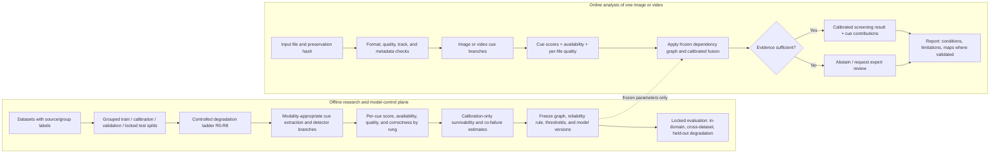

# HyperForensics: Deep Research, Project Audit, and Review-Panel Guide

**Prepared 16 November 2026**  
**Scope:** A research and panel-preparation guide based on the project report, Review 1 and Review 2 decks, paper-bundle manifest, prototype ZIP, and the supplied architecture image. The report distinguishes current prototype behavior from the proposed study and future roadmap.

## Executive summary

HyperForensics is best presented as a **robustness and evidence-reliability study for image and video manipulation analysis**. Its research question is whether measuring how forensic cues survive controlled degradation—and how their errors co-vary—can support more reliable fusion than treating every cue as independent. The graph is a hypothesis to test, not a validated result.

The project files currently describe three different maturity levels. Review 1 is an image/video cue-reliability proposal. The consolidated Rev3 report gives the most rigorous study plan: eight cues, a nine-rung degradation ladder, per-rung cue survivability and co-failure measurements, and controlled fusion comparisons. Review 2’s diagram expands to audio and cross-modal fusion, while the supplied code ZIP is a small synthetic image prototype with seven simple cues and a logistic “star” fusion model. Audio, learned video branches, real-world validation, and a trained graph model are not implemented in that ZIP.

The panel’s clearest story is therefore: **measure first; derive the dependency graph from offline calibration data; freeze it; then compare it on untouched test data against simpler baselines.** The credible contribution is the preregistered cue-survivability/co-failure protocol and its evaluation. Multimodal detection, uncertainty-aware fusion, reliability weighting, and explainable reports already have close prior work, so none of those alone should be claimed as novel.

### Panel-ready abstract

Images and videos are routinely resized, compressed, re-encoded, stabilized, and shared through platforms. These transformations can weaken forensic traces, and cues that appear separate may fail together because they share the same compression, sensor, or processing source. HyperForensics proposes to measure the survivability and joint error behavior of modality-appropriate forensic cues across a controlled nine-rung degradation ladder, then test whether a cue-dependency graph derived on calibration data improves robustness over simpler fusion. The planned evaluation uses source-disjoint data splits, held-out degradation and dataset conditions, per-cue and fused detection metrics, calibration measures, confidence intervals, and ablations. The central hypothesis is that a dependence-derived fusion rule may help under severe degradation or distribution shift; it may not help on clean in-domain data. The current code is a synthetic image prototype and does not establish real-media accuracy. Image/video evaluation is the active study scope; audio and cross-modal analysis remain future work unless the team narrows and implements them explicitly.

### The research question in one sentence

> Given an image or video and an unknown processing history, which applicable forensic cues remain informative, which cues fail together, and does a fusion rule derived only from calibration data improve robustness or calibration over simple baselines on untouched degraded and cross-dataset test data?

## 1. Research conclusion

The proposed problem is real and technically relevant: detectors can perform well on curated benchmarks yet fail to transfer to newer generators, new media sources, and in-the-wild content. Existing research supports several building blocks of HyperForensics: frame-level and temporal video analysis, audio spoof detection, audio-visual synchronization analysis, compression and sensor-noise forensics, and standardized detection/localization evaluation.

The specific end-to-end HyperForensics design—especially a graph that models cue reliability and dependencies before cross-modal fusion—should be presented as a **proposed integration and research hypothesis**. The papers reviewed here do not validate this particular architecture or establish its accuracy. Its central experiment is whether context-aware cue weighting and dependency-aware fusion improve generalization, calibration, and explanation over strong single-branch and simple late-fusion baselines.

## 2. Problem statement and scope

Digital media may be wholly generated, locally edited, face-swapped, reenacted, lip-synced, voice-cloned, or recompressed after editing. A detector that returns only “real” or “fake” can hide which evidence it used and how fragile that evidence is. HyperForensics can instead ask:

1. What manipulation evidence appears in each available modality?
2. How reliable is each cue for this file and these acquisition conditions?
3. Do independent cues agree, conflict, or depend on the same artifact?
4. Is the evidence sufficient for a classification, or should the system abstain and request expert review?

For this capstone, the most defensible active scope is **image/video cue survivability and dependency under degradation**. The Rev3 report puts audio in Phase III; the Review 2 architecture shows an audio branch but the input box shows only image and video, and the supplied prototype is image-only. Unless an audio branch is actually implemented and evaluated, describe it as future work. Likewise, distinguish face-manipulation detection from general AI-generated-media detection and from source-camera attribution: they are related, but they are not interchangeable labels or tasks. Align the title, input box, scope statement, implementation slide, and abstract with what is implemented now.

## 3. What the literature supports

### Visual manipulation detection

- **FaceForensics++** established a large benchmark with DeepFakes, Face2Face, FaceSwap, and NeuralTextures manipulations, compression levels, and a hidden test set. The authors report that domain knowledge improved their detectors in that setting. This supports benchmarked visual detection and compression-aware tests; it does not prove robustness to present-day unseen generators. ([Rössler et al., ICCV 2019](https://openaccess.thecvf.com/content_ICCV_2019/html/Rossler_FaceForensics_Learning_to_Detect_Manipulated_Facial_Images_ICCV_2019_paper.html))
- **Celeb-DF** was introduced because earlier datasets had visible artifacts and did not resemble higher-quality deepfakes. It includes 5,639 higher-quality face-swapped videos and shows why dataset difficulty matters. ([Li et al., CVPR 2020](https://openaccess.thecvf.com/content_CVPR_2020/html/Li_Celeb-DF_A_Large-Scale_Challenging_Dataset_for_DeepFake_Forensics_CVPR_2020_paper.html))
- **DeeperForensics-1.0** adds 60,000 videos, 17.6 million frames, and real-world perturbations. It supports evaluating robustness to distortions, not assuming that one clean test set is enough. ([Jiang et al., CVPR 2020](https://openaccess.thecvf.com/content_CVPR_2020/html/Jiang_DeeperForensics-1.0_A_Large-Scale_Dataset_for_Real-World_Face_Forgery_Detection_CVPR_2020_paper.html))
- **DeepfakeBench** identifies inconsistent data handling, implementations, and evaluation protocols as barriers to fair comparison, and provides a unified benchmark setup. Use its protocol as a reproducibility reference rather than comparing numbers copied from unrelated papers. ([Yan et al., NeurIPS Datasets and Benchmarks 2023](https://papers.nips.cc/paper_files/paper/2023/hash/0e735e4b4f07de483cbe250130992726-Abstract-Datasets_and_Benchmarks.html))
- **DIRE** reports that detectors trained for earlier generated-image families can struggle on diffusion-generated images and evaluates a reconstruction-error cue. This supports holding out generator families and testing features across generation methods; no detector should be treated as universal based on one generator split. ([Wang et al., ICCV 2023](https://openaccess.thecvf.com/content/ICCV2023/html/Wang_DIRE_for_Diffusion-Generated_Image_Detection_ICCV_2023_paper.html))
- A recent in-the-wild benchmark, **Deepfake-Eval-2024**, reports large drops in AUC for open-source image, video, and audio detectors relative to academic benchmarks. This is a primary benchmark paper and an important warning, but its results should be described as that study’s findings, not as a universal estimate of every detector. ([Chandra et al., arXiv preprint, first submitted 2025; version 5 revised 2026](https://arxiv.org/abs/2503.02857))

### Audio and cross-modal evidence

- **ASVspoof 2021** introduced a deepfake-speech track and evaluated systems under channel and compression variability. The challenge authors note that some tracks had no matched training/development data, reflecting unknown attack conditions. This is a useful audio protocol, but ASVspoof’s task scope and attack distribution should not be confused with all modern cloned speech or music. ([Yamagishi et al., 2021](https://arxiv.org/abs/2109.00537))
- **Joint Audio-Visual Deepfake Detection** studies audio-video correspondence and argues that synchronization irregularities can signal manipulations such as face swapping or lip-sync editing. This supports a cross-modal branch as one useful source of evidence. It does not make asynchrony conclusive: ordinary editing, variable frame rates, capture delay, and network transmission can also create a mismatch. The latter is a system-design limitation to test. ([Zhou & Lim, ICCV 2021](https://openaccess.thecvf.com/content/ICCV2021/html/Zhou_Joint_Audio-Visual_Deepfake_Detection_ICCV_2021_paper.html))
- **AV-Deepfake1M** provides a large-scale audio-visual dataset and temporal localization task. It is relevant for training and testing audiovisual evidence, but results on generated benchmark content still need independent testing on in-the-wild data. ([Cai et al., ACM Multimedia 2024](https://arxiv.org/abs/2311.15308))

### Forensic cues

- **PRNU** is a sensor-pattern fingerprint used primarily for source-camera identification and integrity analysis when a reference fingerprint or suitable reference images are available. Research explicitly tests its behavior under compression, resizing, gamma correction, and denoising; other work describes its sensitivity to processing. Therefore PRNU is a conditional cue, not a generic “fake detector,” and it may be unusable or weak on a social-media copy. ([Chen et al., IEEE TIFS 2008](https://doi.org/10.1109/TIFS.2007.916285); [Alles et al., Journal of Forensic Sciences 2009](https://doi.org/10.1111/j.1556-4029.2009.01029.x); [Li et al., 2022](https://arxiv.org/abs/2111.02144))
- **Noiseprint** learns camera-model residual patterns and demonstrates forensic uses including forgery localization. It supports learned low-level traces as a branch, but the source-camera task differs from detecting every kind of synthetic media. ([Cozzolino & Verdoliva, IEEE TIFS 2020](https://arxiv.org/abs/1808.08396))
- **DCT / JPEG quantization analysis** can expose traces associated with double compression or localized editing in JPEG images. These traces depend on the image format and compression history; they should not be used as a universal signal for PNG, video, or audio. ([Lin et al., Pattern Recognition 2009](https://doi.org/10.1016/j.patcog.2009.03.019); [Cozzolino et al., 2021](https://arxiv.org/abs/2108.12947))
- **ELA** (error-level analysis) is best treated as a visualization of differences after JPEG recompression, not a standalone evidential classifier. Its usefulness depends on input format, prior saves, editing history, and interpretation. The system should state that dependency and avoid reporting ELA contrast as proof of tampering.

## 4. Proposed architecture, with evidence boundaries

### Online inference path

1. **Intake and preservation.** Hash and preserve the original upload; record file type, dimensions, duration, codec, sample rate, metadata, and any known transformations. Analyze derived working copies. This is a recommended auditability measure, not a detection result.
2. **Preprocessing and quality checks.** Decode safely; normalize modality-specific formats; detect missing/corrupt tracks; estimate compression, blur, resolution, clipping, and audio-video alignment. Preserve quality indicators as model inputs and report them.
3. **Modality branches.**
   - **Image:** spatial/patch encoder plus appropriate forensic cues (e.g., residual/noise, JPEG/DCT features when applicable).
   - **Video:** sampled frames and face tracks; spatial artifacts plus temporal identity/motion consistency. Avoid random frame-level splitting during evaluation.
   - **Audio (future phase):** a waveform or log-Mel/spectral speech-spoof branch is possible, but it is outside the active image/video study until implemented and evaluated. Keep speech and non-speech claims separate if added later.
4. **Cue extraction and quality estimation.** For every cue, return its value, availability, and conditions that affect reliability. Examples: PRNU only with a source reference; JPEG cues only on compatible files; audio-video sync only when timestamps and tracks are adequate.
5. **Cue-relation graph.** Represent cue observations as nodes and explicit dependencies or agreement as edges. A key design risk is double-counting correlated evidence: ELA and DCT may both reflect the same JPEG history. Estimate these dependencies on labeled offline calibration/development examples grouped by degradation rung; freeze the graph before test evaluation. A single inference file cannot reveal population-level pairwise error dependence by itself. Test the frozen graph against simple score-fusion baselines.
6. **Cross-modal fusion.** Align timestamps and combine calibrated modality scores/features. Missing modality should be represented explicitly; it must not be treated as evidence of authenticity. Compare learned graph fusion to concatenation, attention, and late-score fusion.
7. **Decision and report.** Return a calibrated score, threshold-based label, uncertainty/abstention status, modality contributions, localized evidence maps where validated, quality flags, model version, and limitations. Call the output a screening or decision-support report, not proof of who created the file, intent, provenance, or legal authenticity.

### Offline training and control plane

Curate datasets and labels; keep source identity/video/generation groups together when splitting; document licenses and transformations; train each branch; estimate the graph only after branch baselines are stable; calibrate thresholds on validation data; evaluate on locked in-domain, cross-dataset, unseen-generator, and degraded-media sets. Keep a model card and dataset manifest with every run. The cue-dependency matrix and threshold selection must not use final-test labels.

## 5. Staged capstone experiment

1. **Freeze the question and labels.** Focus the first study on image/video cue survivability and dependency. Distinguish manipulated-vs-authentic, synthetic-vs-camera-captured, and localization tasks; specify how partially edited content is labeled.
2. **Pass the reproduction gate.** Reproduce a selected image/video detector and its data protocol before adding a new fusion model. Record source/video/identity-disjoint splits and reproduce one reported baseline metric.
3. **Start with a bounded Phase I.** Use R0–R4 and the first four cues as in Rev3. Confirm data lineage, transformation settings, cue availability, and per-rung metrics before expanding.
4. **Measure the full ladder and cue relations.** Add cues C5–C8 and R5–R8, with exact transformation parameters and labels. Estimate cue errors/dependencies from calibration data only; freeze this relationship before the final test.
5. **Add the video branch in Phase II.** Introduce C7 and video-specific temporal controls after image measurements are stable. Hold complete source videos and relevant identities/generator groups together across splits.
6. **Compare fusion fairly.** Include the strongest single cue/branch, simple average or late fusion, independence-assuming fusion, fully connected pairwise fusion, and the proposed measured-dependence graph. Keep splits, base scores, seeds, and operating points matched.
7. **Measure robustness and calibration.** Report AUROC, average precision, balanced accuracy, false-positive rate at the operating point, Brier score/ECE, and confidence intervals by rung and domain. For localization, use masks only where ground truth exists. Calibration is separate from accuracy. ([Guo et al., ICML 2017](https://proceedings.mlr.press/v70/guo17a.html))
8. **Treat audio as Phase III.** Audio/audio-visual analysis requires its own data, branch, benign offset/transcoding controls, and evaluation; do not include it as a current capability before that work is done.
9. **Report null results and limits.** If graph fusion does not beat simpler methods, say so. Include abstention for weak/unknown evidence and state that a model result is not proof of provenance, authorship, intent, or legal authenticity.

Use **NIST OpenMFC** as a model for separating detection from localization and for evaluating confidence scores and masks. It defines image/video manipulation detection and localization tasks, including spatial and temporal localization. ([NIST OpenMFC](https://mfc.nist.gov/); [NIST MFC Dataset User Guide](https://nvlpubs.nist.gov/nistpubs/ir/2021/NIST.IR.8377.pdf))

## 6. Example scenarios for the panel

### Scenario A: a re-shared political clip

An uploaded MP4 has low resolution after multiple transcodes. The video branch sees a short interval where face/motion evidence changes; compression-sensitive cues are weak and PRNU is unavailable without a source-camera reference. Correct explanation: “The video branch flags an interval for review; other available cues do not independently confirm it. The file is low quality, so confidence is limited.” Audio-video synchronization is future work in this project phase; do not imply it was measured. Do not say “the speaker definitely said this” or “the clip is proven fake.”

### Scenario B: a JPEG portrait with local retouching

JPEG quantization analysis identifies a local inconsistency, and a noise residual highlights the same region. Because both may arise from a shared recompression/editing history, count them as related evidence rather than two independent confirmations. If no source-camera reference exists, do not claim PRNU identifies the camera or proves manipulation.

### Scenario C: an authentic video with capture delay

Audio and lip movements are offset, but the clip’s timestamp, frame-rate, or recording path can explain the delay. The cross-modal module should lower its reliability estimate, not automatically mark the recording fake. This demonstrates why cue quality and missing-context handling matter.

## 7. Claims the review panel should hear accurately

- “The literature supports the component ideas, but our full graph-fusion framework is our proposed contribution and still needs controlled evaluation.”
- “We will report cross-dataset and unseen-generator results; a high score on one benchmark is not enough to claim forensic robustness.”
- “Our report exposes which cues contributed and when a cue was unavailable or unreliable. It is decision support, not a substitute for expert examination.”
- “The first research question is whether dependency-aware reliability fusion improves generalization and calibrated error behavior over strong simpler baselines.”

## 8. Evidence assessment

| Claim | Evidence strength | Reason |
|---|---|---|
| Curated visual benchmarks support controlled deepfake detector comparison | Moderate to strong | Multiple primary dataset and benchmark papers provide labels, protocols, and baselines; dataset scope is bounded. |
| Cross-dataset and real-world performance can be substantially worse | Moderate | Benchmarks such as Deepfake-Eval-2024 report large drops; results are dataset-, model-, and time-dependent. |
| Video temporal and audio-visual consistency can provide useful signals | Moderate | Primary methods and datasets evaluate these cues, but normal timing/editing variation creates confounds. |
| PRNU/DCT/noise cues can help forensic analysis | Moderate, conditional | Established forensic literature supports specific source/integrity/compression tasks; these traces are format- and processing-dependent. |
| A dependency graph improves accuracy, calibration, or explanation | Insufficient for this project | This is a proposed system-level hypothesis; it needs a direct comparison and ablations. |
| A HyperForensics result can establish authenticity, source, or intent | Unsupported | Binary detector experiments do not establish provenance, authorship, intent, or courtroom admissibility. |

## 9. Selected primary references

1. Rössler et al. (2019), “FaceForensics++.” [ICCV paper](https://openaccess.thecvf.com/content_ICCV_2019/html/Rossler_FaceForensics_Learning_to_Detect_Manipulated_Facial_Images_ICCV_2019_paper.html)
2. Li et al. (2020), “Celeb-DF.” [CVPR paper](https://openaccess.thecvf.com/content_CVPR_2020/html/Li_Celeb-DF_A_Large-Scale_Challenging_Dataset_for_DeepFake_Forensics_CVPR_2020_paper.html)
3. Jiang et al. (2020), “DeeperForensics-1.0.” [CVPR paper](https://openaccess.thecvf.com/content_CVPR_2020/html/Jiang_DeeperForensics-1.0_A_Large-Scale_Dataset_for_Real-World_Face_Forgery_Detection_CVPR_2020_paper.html)
4. Dolhansky et al. (2020), “The DeepFake Detection Challenge Dataset.” [arXiv](https://arxiv.org/abs/2006.07397)
5. Yan et al. (2023), “DeepfakeBench.” [NeurIPS paper](https://papers.nips.cc/paper_files/paper/2023/hash/0e735e4b4f07de483cbe250130992726-Abstract-Datasets_and_Benchmarks.html)
6. Wang et al. (2023), “DIRE for Diffusion-Generated Image Detection.” [ICCV paper](https://openaccess.thecvf.com/content/ICCV2023/html/Wang_DIRE_for_Diffusion-Generated_Image_Detection_ICCV_2023_paper.html)
7. Chandra et al. (2025/2026), “Deepfake-Eval-2024.” [arXiv version history](https://arxiv.org/abs/2503.02857)
8. Zhou & Lim (2021), “Joint Audio-Visual Deepfake Detection.” [ICCV paper](https://openaccess.thecvf.com/content/ICCV2021/html/Zhou_Joint_Audio-Visual_Deepfake_Detection_ICCV_2021_paper.html)
9. Yamagishi et al. (2021), “ASVspoof 2021.” [arXiv](https://arxiv.org/abs/2109.00537)
10. Cai et al. (2024), “AV-Deepfake1M.” [ACM DOI](https://doi.org/10.1145/3664647.3680795)
11. Chen et al. (2008), “Determining Image Origin and Integrity Using Sensor Noise.” [DOI](https://doi.org/10.1109/TIFS.2007.916285)
12. Alles et al. (2009), “Source camera identification for heavily JPEG compressed low resolution still images.” [DOI](https://doi.org/10.1111/j.1556-4029.2009.01029.x)
13. Cozzolino & Verdoliva (2020), “Noiseprint: A CNN-Based Camera Model Fingerprint.” [arXiv](https://arxiv.org/abs/1808.08396)
14. Lin et al. (2009), “Fast, automatic and fine-grained tampered JPEG image detection via DCT coefficient analysis.” [DOI](https://doi.org/10.1016/j.patcog.2009.03.019)
15. Guo et al. (2017), “On Calibration of Modern Neural Networks.” [PMLR](https://proceedings.mlr.press/v70/guo17a.html)
16. Guan et al. (2021), “User Guide for NIST Media Forensic Challenge Datasets.” [NIST](https://nvlpubs.nist.gov/nistpubs/ir/2021/NIST.IR.8377.pdf)

---

## 10. Project-file audit: what each source says

I reviewed the named project report, both review decks, both ZIP bundles, the supplied architecture image, and the two additional HyperForensics PDFs found alongside the named materials. `sources/` in the project workspace is read-only and was not changed.

### Which source should govern which claim?

| Material | What it establishes | How to use it in the panel |
|---|---|---|
| **Consolidated Project Report Rev3** (5 Sep 2026) | The strongest study definition: eight cues, five evidence origins, R0–R8 degradation ladder, hypotheses H1–H3, phases, and novelty caveats. | Use as the main authority for the research question and planned protocol. It explicitly treats this as a measurement study, not proof that graph fusion works. |
| **Review 1 deck** | Initial image/video reliability framing: eight cues, nine degradation levels, cue reliability, and cue relation. The tagline is effectively “evidence wears away through resharing.” | Use to explain the original problem and what the project is trying to measure. |
| **Review 2 deck** | Expanded literature overview and a broader image/video/audio architecture; shows early implementation graphics. | Use as the design evolution and expected panel coverage. Treat the audio branch as roadmap unless backed by implementation and results. |
| **`star-cue-reliability.zip`** | A runnable educational prototype for synthetic/composited still images, a simple ladder, seven hand-built image cues, and logistic star-style fusion. | Use to demonstrate that a pipeline prototype exists. Do not call it a validated HyperForensics model or use its toy outputs as real-media performance evidence. |
| **30-paper bundle ZIP** | A manifest and 30 web shortcuts/records, plus a download-attempt script. It does **not** contain 30 PDF papers. | Use the manifest as a reading list. Open the paper landing pages and obtain the actual papers through their publishers/repositories before citing methods or results in a thesis. |
| **`HyperForensics_Updated_Literature_Survey_DeepfakeBuster.pdf`** (8 Oct 2026) | Surfaces a narrower alternative study: paired authentic images before/after benign AI processing, and the risk of false alarms/calibration drift. | Keep this as a valuable Phase I stress test or explicitly choose it as the project’s main scope. Do not silently mix it with the broader cue-graph study. |
| **`HyperForensics_Panel_Handout_DeepfakeBench_SIDA.pdf`** | Focuses on benchmark infrastructure and SIDA (detection, localization, explanations). | Use to explain strong baselines and prior work. It reinforces that explanation and multimodal analysis are not novel by themselves. |
| **Supplied architecture screenshot** | Same visual design as the Review 2 architecture slide: online inference above, training/control plane below. | Keep the visual but clarify the offline/online boundary, remove unimplemented audio from the “current system” view, and make cue-dependency estimation a training-time operation. |

### Review 1 → Review 2: what changed and what still needs correction

Review 1 frames the project around images and videos, degradation, eight forensic cues, and reliability/dependence. Review 2 adds more recent related work, an explicit architecture, and early graphics for correlation and fusion. This is a sensible presentation progression. However, the Review 2 architecture and implementation graphics do not yet line up with the Rev3 study plan or code:

- The architecture draws an **audio branch** and **cross-modal fusion**, but its input-media box shows only image and video. The code ZIP is still-image only. Mark audio and cross-modal analysis as future work, or implement and report them before calling them current capabilities.
- The diagram makes “Cue Relation” look like an inference-time pipeline. Pairwise cue error dependence is estimated over many labeled examples in the offline calibration set. A single incoming file can produce cue values and quality estimates; it cannot by itself establish the population-level dependency matrix. Freeze the graph before final testing.
- The Review 2 plot labels only C1–C4 and R0–R4. Its two example graphics do not show a complete eight-cue/R0–R8 study. The figures also lack run ID, dataset split, seed, sample counts, and script/config reference. Present them as **prototype illustrations** unless the team can attach this provenance and reproduce them.
- The ZIP prototype has seven image cues (C1–C6 and C8), not the eight planned cues. It has no video C7 and no learned audio/video detector. Its one-file explanation output is a score/trust summary, not a validated causal explanation or pixel-level evidence map.
- Review 2 summarizes “suggestions” but the supplied deck does not preserve a verbatim list of reviewer comments. In the defense, say “we responded by…” only for changes the team can verify. Present scope cleanup, expanded literature, clearer data flow, and an evaluation plan as the team’s actions; do not invent quotations from the panel.

### The scope decision the team needs to state plainly

Three related but distinct directions appear across the materials:

1. **Main Rev3 direction (recommended):** measure image/video cue survivability and co-failure under controlled degradations, then test dependence-derived fusion.
2. **Paired genuine-image stress test:** measure false-positive and calibration changes when an authentic image is resized, enhanced, or processed by benign AI tools. This can be a high-value early experiment within direction 1.
3. **Multimodal audio/video direction in Review 2:** detect audio/video manipulation and cross-modal inconsistency. Keep it as future work (Rev3 Phase III audio) unless it becomes the explicitly narrowed project with data, code, and evaluation.

For this review, I recommend direction 1 as the central capstone question, with direction 2 as a carefully labeled benign-processing condition. This preserves the clearest lineage from Review 1 and Rev3, gives the panel a testable contribution, and avoids claiming an audio/video system that is not in the supplied prototype.

## 11. The proposed system, explained as two workflows

The clearest way to present the architecture is to separate **offline learning and measurement** from **online file analysis**. The diagram below makes the critical data boundary visible.

**Explain the arrows:** offline labels let the team learn how cues behave across many examples and degradation levels. The result is a frozen set of reliability/fusion parameters. At inference, the system analyzes one file and applies those frozen parameters to its cues and observable quality. It does not recompute “cue correlation” from that one file. The final branch is a calibrated screening result or abstention, not a declaration of legal authenticity.

### The eight planned cues: what they mean and when to trust them

| ID | Planned cue | What it tries to detect | Where it can help | Important condition / failure mode |
|---|---|---|---|---|
| C1 | Error Level Analysis (ELA) | JPEG recompression differences that may highlight inconsistent regions | A quick visualization for JPEG images with a known processing context | Not a proof of editing. Results change with JPEG quality and save history; weak or meaningless for many non-JPEG inputs. |
| C2 | Block-DCT statistics | Block and frequency patterns associated with compression or local processing | JPEG/compression analysis | Can reflect ordinary compression history, not manipulation specifically. Correlated with C1/C3. |
| C3 | JPEG quantization history/ghost | Inconsistent quantization tables or traces of repeated/local JPEG compression | Recompression and some splicing workflows | Resizing, transcoding, export, or platform processing can erase or alter the traces. Format-specific. |
| C4 | Sensor PRNU/noise | Whether sensor noise is consistent with a known source/reference | Source-camera consistency when adequate reference images exist | Requires a reference for meaningful source attribution; stabilization, denoising, resizing, and compression weaken it. Not a generic synthetic-media detector. |
| C5 | Generator/resampling signature | Resampling or synthesis traces in image formation | Some synthetic/edited images under studied generators and processing | Generator families and post-processing shift; hold out generators and avoid claiming universality. |
| C6 | Illumination/geometry consistency | Inconsistency in lighting, shadows, perspective, or scene geometry | Some compositing and face-edit cases | Natural scenes, unusual lighting, and benign retouching can confuse it; needs region/context-aware evaluation. |
| C7 | Temporal/semantic consistency | Frame-to-frame identity, motion, blink, or lip/motion inconsistency | Video-only manipulation analysis | Not an image cue; compression, cuts, low frame rate, and capture artifacts can mimic discontinuity. Not implemented in the supplied ZIP. |
| C8 | Container/metadata | File/container history or metadata inconsistency | Triage and provenance context | Metadata can be stripped, rewritten, or forged. Missing metadata is not evidence of manipulation. |

The Rev3 report says the eight cues span five evidence origins, but the review slides do not make the parent grouping explicit. Put the five group names beside the cue list in the final deck and keep the mapping consistent across the report, code, and figures. A working grouping for the slides is compression, sensor, generation/resampling, scene/temporal consistency, and container/provenance traces; confirm it against the exact Rev3 definitions before finalizing. This diversity is useful only if the team measures each cue and its shared failure modes. For example, C1, C2, and C3 may all respond to JPEG history, so agreement among them is not three independent confirmations.

## 12. Study design the panel can audit

### Preregistered hypotheses from the project report

- **H1 — Cue survivability differs:** cue performance changes differently across R0–R8; there is no single degradation response shared by all cues.
- **H2 — Cue errors co-fail:** cues with shared evidence origins have correlated errors, and those relationships change with degradation.
- **H3 — A measured-dependence graph can help in selected conditions:** a graph derived only from calibration data may improve calibration or detection under heavy degradation and/or cross-dataset shift, while offering little or no gain on clean in-domain data.

H3 is deliberately conditional. A null result is still informative: it can show that the graph is unnecessary, too noisy, or not better than simpler fusion under the tested conditions.

### R0–R8 degradation ladder from Rev3

| Rung | Meaning in the project plan | What to record |
|---|---|---|
| R0 | Near-lossless source / minimal processing | Source format and any unavoidable export step |
| R1 | One high-quality encode/compression | Codec/quality setting and whether it is aligned to source blocks |
| R2 | Medium-quality encode/compression | Same settings and parent file as R1 where possible |
| R3 | Double compression, aligned or mismatched | Both encode parameters and grid alignment |
| R4 | Shifted block grid for images or GOP shift for video | Exact shift/encoding operation; retain modality-specific definition |
| R5 | Resize followed by JPEG/re-encode | Resize dimensions/filter and final encoding settings |
| R6 | Aggressive compression | Exact codec and quality/bitrate rather than just “low quality” |
| R7 | Multiple generations of compression and/or video stabilization | Number of generations and stabilization method/settings |
| R8 | Platform upload/download round trip | Platform, date, privacy/processing path, and resulting metadata; simulated transforms must be labeled simulated |

The source report gives the rung concepts, but the exact numerical parameters should be frozen by the team in a protocol before testing. The prototype’s R8-like transformation is simulated and must not be presented as an actual platform round trip.

### Recommended protocol

1. **Define labels and units.** Decide whether the task is manipulated-vs-authentic image/video, synthetic-vs-camera-captured, or localized manipulation. State whether partially edited media receives a file-level positive label and whether segment/mask labels are available.
2. **Group before splitting.** Keep source image, identity, original video, camera/device, and generated/manipulated derivative in the same split. Do not let adjacent video frames or transformed copies cross splits.
3. **Separate fit/calibration/test roles.** Train detector branches on the training split; estimate cue reliability/dependency on calibration data; select thresholds and probability calibration on validation data; evaluate once on locked test data. Any topology/threshold change after test inspection requires a new held-out test set.
4. **Freeze the corruption recipe.** Define the exact operations and parameter values for R0–R8 before running results. Preserve the unmodified parent asset, transformation code/version, codec settings, random seed, and output hash. Label R8 accurately: the ZIP simulates platform-like transformations; it does not perform a real platform upload/download round trip.
5. **Use a staged scope.** Rev3’s Phase I is a reproduction gate plus a smaller image study (R0–R4 and four cues); Phase II adds the remaining cues, full ladder, video, and a three-way fusion ablation; audio is Phase III. Keep each phase’s claims separate.
6. **Compare fair baselines.** Use the same data splits and base cue inputs for: (a) strongest single cue/branch, (b) simple mean or late fusion, (c) independence-assuming reliability fusion, (d) fully connected pairwise model, and (e) proposed measured-dependence graph. The code prototype’s star model is another baseline, not the graph itself.
7. **Repeat and quantify uncertainty.** Run multiple seeds where training is stochastic. Report confidence intervals, preferably with bootstrap resampling grouped by source/video rather than by frame. Report per-rung and per-dataset results; do not hide failures inside one aggregate.
8. **Audit explanations.** If the report highlights regions, evaluate them against localization masks and perturbation tests. If it only lists cue scores/contributions, call that a contribution summary, not a validated causal explanation.

### Metrics to show

| Question | Recommended measure |
|---|---|
| Does detection rank manipulated items above authentic ones? | AUROC and average precision, by rung and test domain |
| Does it work at the chosen decision threshold? | Balanced accuracy, sensitivity, specificity, false-positive rate, and confusion matrix |
| Are confidence values meaningful? | Brier score, ECE with binning details, and reliability plots by rung/domain |
| Does it locate manipulated content? | Pixel/frame precision-recall and IoU only when trustworthy masks or temporal labels exist |
| Does the graph add value? | Paired metric difference versus each baseline with confidence intervals; ablate each cue and cue group |
| Is the outcome fair across content groups? | Group-wise error rates where sample size permits, with counts and uncertainty |

Do not rely on accuracy alone for class-imbalanced data. Predefine an operating point and the rule for “insufficient evidence.” If using a numeric “severe degradation” cutoff, set it before opening the test results.

## 13. What the supplied code ZIP really demonstrates

The `star-cue-reliability.zip` archive is useful as a prototype because it gives the team something concrete to explain: synthetic data generation, image transformations, cue extraction, a toy classifier/fusion method, and result artifacts. Its limits should be stated clearly.

| Component | In the ZIP | What it does **not** establish |
|---|---|---|
| Data | Synthetic grayscale camera-like scenes and composited splice patches; a small `results_photo` mode built from public sample photos with synthetic overlays/camera effects | Real-world forensic validity, representative camera/source distribution, broad manipulation coverage, or an external validation set |
| Degradation | R0–R8-like simulated transforms; R8 is resize/sharpen/JPEG plus metadata stripping | A real platform round trip, which may add unknown codec, crop, stabilization, or recompression behavior |
| Cues | Seven simple image cues C1–C6 and C8; PRNU/metadata are simplified or neutral where a real source reference is absent | Planned C7 temporal cue, eight fully validated cues, local pixel masks, or a learned video/audio branch |
| Fusion | Logistic “star” reliability fusion and comparison variants | A graph neural network or a validated graph learned from real cue co-failure trajectories |
| Explanation | Per-file scores/trust and rung-level summaries | A calibrated forensic probability, causal attribution, validated saliency map, or proof of source/authorship |
| Evaluation | Small precomputed toy results, one seed, and small sample sizes | Statistical confidence, repeatability across runs, true cross-dataset generalization, or benchmark-level claims |

There are two useful cautions in the implementation. First, the reported `results_photo` run has mean in-domain AUROC around **0.769** for star reliability versus **0.696** for damage-augmented fusion, but on its shifted synthetic set the star score is around **0.594** versus **0.591**, while a different single/fully connected baseline is reported around **0.672**; star plus co-failure is around **0.580**. These are tiny toy-set, one-run prototype numbers, not project evidence. They actually reinforce why the graph hypothesis must be tested against alternatives. Second, the measurement code returns zero for some dependency statistics when the denominator has no variation; that case should be reported as undefined/insufficient data, not as evidence that cues are independent. Add repeated grouped evaluation and confidence intervals before making any empirical claim.

**Safe panel wording:** “We have a CPU prototype that exercises a synthetic image pipeline and lets us inspect candidate cue/fusion behavior. It is a feasibility demonstration. The research evaluation with real, grouped data and locked testing is the next stage.”

## 14. Prior work and the defensible gap

The literature bundle is valuable, but it also makes broad novelty claims unsafe. The strongest version of the contribution is a **specific measurement protocol and falsifiable fusion test**, not “the first multimodal detector,” “the first reliability model,” or “the first explainable system.”

| Work | What is already established | Consequence for HyperForensics |
|---|---|---|
| **COF** (2026 preprint) | Measures multiple uncertainty sources across detectors and datasets; reports meaningful error/uncertainty relationships. | Uncertainty/deepfake reliability is active work. Differentiate by forensic cue survivability and calibration-only co-failure topology, if the experiment truly does that. [arXiv](https://arxiv.org/abs/2606.06666) |
| **DiCoME** (ICML 2026) | Decomposes semantic/artifact views and uses uncertainty-aware evidential learning. | Conflict-aware evidence fusion is not new by itself. Compare against evidential/late-fusion style baselines where feasible. [PMLR](https://proceedings.mlr.press/v306/kang26o.html) |
| **Beyond Backbones** (CVPRW/NTIRE 2026) | Degradation-aware prototype fusion and strong benchmark performance, including a reported 84.3 AUC in its stated challenge setting. | “Degradation-aware fusion” alone is not a defensible novelty claim. State the difference in measured cue-level survivability and learned topology. [CVF paper](https://openaccess.thecvf.com/content/CVPR2026W/NTIRE/papers/Negi_Beyond_Backbones_Degradation-Aware_Prototype_Fusion_for_Robust_Deepfake_Detection_CVPRW_2026_paper.pdf) |
| **DeepfakeBuster** (Scientific Reports, 2026) | Heterogeneous cues, reliability priors, and image-specific confidence; reports results on a large dataset of its own. | Reliability-weighted heterogeneous fusion and confidence are close prior art. Its headline performance belongs to its dataset/protocol, not proof of generalization. [Nature](https://www.nature.com/articles/s41598-026-61247-6) |
| **SIDA** (CVPR 2025) | Detection, localization, and explanation in a unified setting. | Do not claim explanation/localization novelty without distinguishing the method and validating maps. [CVF](https://openaccess.thecvf.com/content/CVPR2025/html/Huang_SIDA_Social_Media_Image_Deepfake_Detection_Localization_and_Explanation_with_CVPR_2025_paper.html) |
| **Omni-Fake** (CVPR 2026) | Unified multimodal social-media deepfake benchmark, including out-of-distribution evaluation, localization, and explanation. | Multimodal + OOD + explanation has direct recent precedent. [CVF](https://openaccess.thecvf.com/content/CVPR2026/html/Li_Omni-Fake_Benchmarking_Unified_Multimodal_Social_Media_Deepfake_Detection_CVPR_2026_paper.html) |
| **FVBench** (CVPR 2026) | Evaluates video detection across real, AI-edited, and fully synthetic sources and many video models. | The study should compare its video scope and held-out conditions against current benchmark practice. [CVF](https://openaccess.thecvf.com/content/CVPR2026/html/Wang_FVBench_Benchmarking_Deepfake_Video_Detection_Capability_of_Large_Multimodal_Models_CVPR_2026_paper.html) |
| **DeepfakeBench** (2023 paper; evolving official repository) | Standardized data handling/evaluation; original paper covers 15 methods and 9 datasets. Current repository README lists 36 detectors. | Cite the 2023 paper and current repository separately. Use a reproducible benchmark baseline, but verify current dependencies and compatible checkpoints before committing to its older environment. The repository is CC-BY-NC-4.0. [Paper](https://arxiv.org/abs/2307.01426) · [official repository](https://github.com/SCLBD/DeepfakeBench/blob/main/README.md) |
| **Deepfake-Eval-2024** | In-the-wild benchmark with real online media; the paper reports lower performance for tested open-source detectors than on academic benchmarks. | Strong motivation for shift testing; describe its findings as specific to the evaluated models/data. [arXiv](https://arxiv.org/abs/2503.02857) |
| **FIDD-6000** | Social-media image forensics dataset. | Relevant to platform processing and social-media conditions; check labels, permitted use, and fit to the study. [MDPI](https://www.mdpi.com/2224-2708/15/3/40) |

**Suggested novelty statement:** “Our contribution is a controlled, per-cue study of survivability and joint failure across a defined image/video degradation ladder, together with a preregistered test of whether a cue-dependency graph derived from calibration data improves detection or calibration under held-out degradation and dataset shift. We will compare it with independence, late-fusion, and fully connected alternatives, and report negative results.”

This wording should remain conditional until the team has run the protocol. Before submission, perform a fresh related-work search because the area is moving quickly and the exact graph rule must be compared with papers beyond the 30-item bundle.

## 15. Domains and examples the panel can understand

| Domain | Potential use | What HyperForensics could contribute | Important limit |
|---|---|---|---|
| Newsrooms and fact-checking | Triage incoming images/videos and prioritize expert review | Show which traces survive platform sharing and provide a transparent, calibrated screening summary | A score cannot authenticate a source or establish the truth of a claim |
| Incident response / cyber investigations | Prioritize media for deeper examination and preserve analysis context | Record file hashes, processing conditions, cue availability, model version, and uncertainty | Chain of custody and independent forensic procedures are still required |
| Social platforms | Flag suspicious uploads for human review | Study false positives and robustness after resize/re-encode workflows | Automated moderation errors can affect users; threshold and appeal policy matter |
| Journalism / public communication | Explain why an item was flagged and what remains uncertain | Cue-level contribution summary and limitations | Do not label a person or file “fake” as a fact from one model output |
| Digital forensics education | Demonstrate compression, sensor, metadata, and temporal cues | Reproducible controlled degradation exercises | Educational prototypes are not evidence of field accuracy |
| Archival/media preservation | Compare files across known transformation histories | Characterize which traces are lost after conversion | Metadata absence or change alone cannot establish tampering |

### Worked example: a manipulated portrait after repeated sharing

Start with a JPEG portrait that contains a small pasted region. On R0 or R1, C2/C3 may detect an inconsistent JPEG history and C6 may flag a lighting/geometry conflict. C1 may show a different recompression level around the region, but that display alone is not proof. After multiple resize/re-encode steps, C1–C3 may all weaken together because they share compression evidence. C4 (PRNU) is only meaningful if a valid camera reference is available and the processing left enough sensor trace. If the cues become weak or disagree, the correct result is “insufficient reliable evidence; refer for expert review,” not “authentic.”

### Worked example: an authentic image enhanced by an AI tool

Take an authentic photograph and compare its original to a benign super-resolution or denoising result. The processed version may lose sensor noise or gain resampling patterns, while its depicted content remains genuine. HyperForensics should identify a changed processing signature and lower confidence where the relevant cue is known to be fragile; it should not turn “AI-processed” into “AI-generated” or “manipulated.” A paired-original condition is an especially useful false-positive test.

### Worked example: a forwarded video with an apparent audio/visual offset

If a video branch exists, it can flag a segment with motion/identity inconsistency. An apparent lip-sync offset could be caused by editing, variable frame rate, capture delay, or transcoding. In the current capstone scope, audio/video alignment is not a measured branch; present this only as a future example. If the team later implements it, require timestamp/quality checks and benign offset controls before treating as manipulation evidence.

## 16. How to start the implementation, in order

1. **Hold a short team scope meeting.** Agree on one primary task: image/video cue survivability and dependency. Mark audio as future. Decide whether benign AI enhancement is an explicit test condition.
2. **Turn Rev3 into a one-page protocol.** Write the label definition, dataset list, split groups, exact R0–R8 operations, four-cue Phase I subset, metrics, graph rule, baselines, and exclusion rules before running the final experiment.
3. **Inventory source data and permissions.** Record data version, source IDs, labels, masks/segments, licenses, and hashes. Keep derivative copies linked to original source IDs.
4. **Pass the reproduction gate.** Reproduce one selected detector and one benchmark result with a clean environment and fixed split. DeepfakeBench is a candidate reference, but its current environment and checkpoint compatibility must be checked; the paper’s 15-method count differs from the current repository’s 36 detectors. Rev3 mentions an RTX 5090; the repository’s older PyTorch/CUDA setup may not support that GPU without a compatible environment or a different baseline, so resolve this before promising a reproduction date.
5. **Implement R0–R4 for four cues first.** Keep the first milestone small enough to debug. Save both original and transformed media and transformation metadata. Confirm that each cue returns score, availability, and quality reason.
6. **Measure before fusing.** Plot each cue’s score distribution, AUROC, calibration, error rate, and availability by rung. Estimate pairwise correctness/error dependence on calibration data only. If a cue has too few valid observations or no variance, mark the relationship unknown.
7. **Run the three-way fusion test.** Compare independence-assuming, fully connected pairwise, and measured-dependence graph approaches under the same splits/seeds. Include simple single-cue and late-fusion baselines so the graph must earn its complexity.
8. **Expand only after the first gate is stable.** Add the remaining cues/full ladder, then video temporal analysis. Do not add the Phase III audio branch until the image/video measurements and evaluation setup are reproducible.
9. **Package provenance.** For every figure, include dataset/split, sample counts, cue IDs, degradation rung, seed, script/config version, and output path. Replace or relabel current Review 2 graphics if that information is unavailable.

## 17. Review-panel presentation plan

### Suggested speaker order

Use roles rather than inventing names; map these roles to your actual team members:

1. **Presenter/team lead:** hook, practical problem, exact research question, and current scope.
2. **Research/literature lead:** what prior work establishes, where HyperForensics differs, and the three hypotheses.
3. **Architecture/implementation lead:** walk through offline vs online flow, cues, code prototype, and what is not implemented yet.
4. **Evaluation lead:** degradation ladder, grouped data splits, baselines, metrics, ablations, and what would count as success or a null result.
5. **Presenter/team lead:** use case, limits, milestones, and invite questions.

If only one person presents, keep the same order. Do not begin by listing technologies; first establish the problem the tools solve.

### A clear opening (about 90 seconds)

> “A forensic detector can see several clues in an image or video, but those clues do not survive sharing equally. Compression may erase some traces, and several cues may fail together because they depend on the same processing history. Our project asks whether we can measure that behavior and use the measurements to combine evidence more responsibly. We define eight candidate cues and a nine-step degradation ladder. In offline calibration data, we measure each cue’s survivability and which errors co-occur; then we freeze that dependency model and evaluate it on held-out data against simpler fusion methods. Our primary claim is a testable research design, not that a graph already beats every detector. The code we have now is a synthetic image prototype, so the next step is reproducing a baseline and validating the protocol with real grouped data. The intended output is a screening report that explains available evidence and uncertainty, not proof of who created a file.”

### Recommended slide order

1. Real-world motivation and one benign degradation example.
2. Precise problem statement and distinction between manipulation, synthetic generation, and source attribution.
3. Review 1 feedback / evolution: what was clarified or added, without inventing exact reviewer quotes.
4. Related work and novelty boundary (2–3 high-value comparisons only).
5. Hypotheses H1–H3 and the nine-rung ladder.
6. Proposed architecture with offline/online separation.
7. Current implementation: show a traced prototype example and label synthetic outputs honestly.
8. Evaluation plan: datasets, splits, baselines, metrics, ablation, and confidence intervals.
9. Applicability, failure/abstention example, limitations.
10. Timeline, next milestone, and conclusion.

### Questions the panel is likely to ask

| Likely question | Answer to prepare |
|---|---|
| “What is actually new?” | The measured cue survivability/co-failure study and preregistered calibration-only graph test—not multimodal detection or explainability in general. |
| “Why use a graph?” | It gives an explicit way to represent cue dependencies and avoid double-counting. It is justified only if it beats simpler fusion on prespecified held-out outcomes. |
| “How do you prevent leakage?” | Group original/derivative images, identities, videos, cameras, and generators before splitting; estimate graph and calibration only on calibration/validation; keep test locked. |
| “How do you know PRNU?” | We do not infer a camera from PRNU without a suitable reference. We mark it unavailable or low reliability when no reference or adequate signal exists. |
| “What if the graph does not improve results?” | That is a valid finding. We report it and use the simpler method; the study still measures survivability and co-failure. |
| “Is the current model multimodal?” | No. The provided prototype is a synthetic still-image prototype. The architecture includes a future audio concept; audio/video branches require implementation and evaluation before being called current. |
| “Why include ELA?” | As a low-cost JPEG diagnostic candidate to measure, not as proof of manipulation. We will compare it with other cues and report when it is inapplicable. |
| “Can it prove authenticity?” | No. It provides calibrated screening evidence with limitations and can abstain; provenance/authorship/intent require independent evidence and expert process. |
| “Why not use one large model?” | Strong learned detectors belong in the baseline comparison. HyperForensics asks whether explicit cue condition/dependence measurement adds robustness and auditability; the experiment must show whether it does. |
| “Which dataset will you use?” | Name only the datasets the team has actually obtained and can lawfully use. Explain group split and the held-out condition; do not promise every dataset in the literature. |

## 18. Claims to use, and claims to avoid

**Use:**

- “We propose and will test a calibration-only cue-dependency graph.”
- “The current prototype demonstrates a synthetic image pipeline; it is not validated forensic performance.”
- “We measure performance and confidence separately across degradation conditions.”
- “The system can abstain when cues are unavailable, low quality, or contradictory.”
- “We distinguish evidence of processing from evidence of malicious manipulation.”

**Avoid unless new evidence is produced:**

- “Our model proves an image/video is fake or authentic.”
- “Our graph is a GNN” or “the graph is learned end to end” (the ZIP’s star model is logistic fusion).
- “We support audio/video/multimodal inference” (not demonstrated by the ZIP).
- “The model is 97.8% accurate” (that number is reported by another study on its own data/protocol, not HyperForensics).
- “The 30-paper ZIP contains 30 full-text PDFs.”
- “Our heatmap explains the model” without localization/faithfulness evaluation.
- “Missing metadata or weak PRNU means manipulation.”

## 19. Paper bundle and link audit

The paper ZIP’s README says the bundle contains **30 records and URL shortcuts, not the 30 full-text PDFs**. Its manifest was inspected for citation and link records. The following inventory groups the 30 papers so the team can prioritize reading; titles below follow the bundle’s manifest/records:

1. COF (uncertainty and co-failure in deepfake detectors)
2. DiCoME (decomposed views and uncertainty-aware multimodal detection)
3. Beyond Backbones: Degradation-Aware Prototype Fusion
4. DeepfakeBuster
5. Bridging the Gap (the bundle’s 2025 deepfake detection paper)
6. NTIRE 2026 deepfake detection challenge report
7. Kuncheva & Whitaker (2003), classifier-combination measures
8. Goebel & Yan (2005), feature selection / machine-learning reference
9. Fontani et al. (2013), Dempster–Shafer evidence fusion for multimedia forensics
10. FIDD-6000
11. Deepfake-Eval-2024
12. So-Fake
13. DeepfakeBench
14. TruFor
15. Graph neural networks for deepfake detection (IEEE TIFS, 2024)
16. SIDA
17. Omni-Fake
18. FVBench
19. FaceForensics++
20. Celeb-DF
21. Self-Blended Images
22. “Lips Don’t Lie” (audio-visual consistency)
23. AltFreezing
24. PRNU-based video source attribution
25. Forensic analysis of video metadata
26. Codec/GOP identification for double-compressed video
27. Noiseprint
28. Gradient-based illumination estimation
29. GAN fingerprints
30. Estimating prior JPEG quantization factor

**What was verified and what was not:** the central paper records and selected authoritative landing pages were checked. Primary links for COF, DiCoME, DeepfakeBuster, Deepfake-Eval, So-Fake, DeepfakeBench, and FIDD-6000 resolve to the stated records; official CVF search results identify the cited 2025/2026 works. Some publisher/CVF/DOI pages are blocked or return access errors in the research reader. Such an access error does not establish that a paper link is dead. Treat the bundle as a link inventory, then verify each citation in the publisher or repository before final academic submission. The ZIP’s README also records citation corrections: Goebel & Yan is 2005 (not 2004); Matern et al. is online 2019/volume 2020; Noiseprint is arXiv 2018/journal 2020.

### Priority reading order for this capstone

1. **Closest novelty checks:** COF, DiCoME, Beyond Backbones, DeepfakeBuster, SIDA, Omni-Fake, FVBench.
2. **Protocol and baselines:** DeepfakeBench, Deepfake-Eval-2024, FIDD-6000, NTIRE 2026 report, TruFor.
3. **Cue foundations:** PRNU video attribution, Noiseprint, JPEG quantization, DCT, illumination, video metadata, codec/GOP, GAN fingerprints.
4. **Video/audio extensions:** FaceForensics++, Celeb-DF, Self-Blended Images, Lips Don’t Lie, AltFreezing, AV-related benchmark papers; read these only as support for the implemented scope, not as a substitute for its own evidence.

The ZIP also includes three source-citation corrections noted above. Check title, author list, venue/year, version, DOI/arXiv record, and what the method actually evaluates before placing each in the final thesis. In particular, distinguish a preprint from peer-reviewed proceedings and a paper’s original detector count from a repository’s current contents.

## 20. Concrete next deliverable for the team

Before the next panel rehearsal, prepare one compact evidence packet containing:

- one signed-off scope sentence and one research question;
- a versioned protocol table for R0–R8, including which transformations are real platform operations versus simulations;
- a data manifest with source-group split and license/availability;
- one baseline reproduction record (environment, checkpoint, split, seed, metrics);
- cue-by-rung plots with counts, confidence intervals, and “not applicable/undefined” handling;
- a frozen graph specification and the exact three-way ablation;
- a provenance strip on every figure: dataset/split, run ID, cue IDs, rung, seed, sample count, and script/config version;
- a slide that says clearly what is implemented now, what is planned next, and what is future work.

The review panel should leave understanding four things: the problem is cue fragility under ordinary media processing; the method measures cue survival and co-failure; the graph is tested fairly against simpler alternatives; and the system reports uncertainty rather than claiming forensic certainty.

